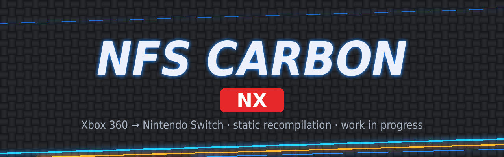

<div align=center>



</div>
<h1 align=center>Need for Speed: Carbon — Nintendo Switch port (nfscarbon-nx)</h1>

An **unofficial, work-in-progress** native Nintendo Switch port of the Xbox 360 version of **Need for Speed: Carbon**
(2006).

It is not an emulator. The PowerPC code of the game's `default.xex` is statically recompiled to C++ with
[ReXGlue](https://github.com/rexglue/rexglue-sdk), compiled for the Switch with devkitA64, and the game is drawn by a
native Vulkan renderer running on NVK (Mesa).

> [!IMPORTANT]
> **Playable.** The game boots, the menus, career, cutscenes and races all work, with sound and videos. At the
> Switch's stock clocks it runs at about 28 FPS in races at 540p, with dips at crowded race starts; an overclock
> brings it to a steady 30 FPS outside the heaviest moments (see [Performance](#performance)). Video settings
> (resolution, FPS limit, motion blur, anti-aliasing and more) are in the game's own **Options > Video** screen.
> Editions: **USA**, **Europe**, **Europe (Nordic)**, **France**, **Italy**, **Germany**, **Spain** and both
> **Collector's Editions** (see [Edition](#edition)). Latest version: see [Releases](../../releases).

## Performance

Measured on the Collector's Edition (Europe) in handheld mode, all settings as shipped in `nfscarbon.toml` apart
from the resolution, four CPU cores ([how](#experimental-the-fourth-cpu-core)), in Race Wars and circuit races. The
game is locked to 30 FPS by design, as on the Xbox 360; menus, free roam and cutscenes run at 30 at every setting
below. All nine editions run the same code and perform the same.

| CPU / GPU / RAM (MHz) | Resolution | Race starts (whole pack on screen) | Rest of the race |
|---|---|---|---|
| 1020 / 460.8 / 1331 (stock) | 540p | 19 FPS | 28 FPS |
| 1224 / 614.4 / 1600 | 540p | 24 FPS | 30 FPS |
| 1326 / 691.2 / 1600 | 540p | 25 FPS | 30 FPS |
| 1326 / 691.2 / 1600 | 720p | 23.5 FPS | 26.5 FPS |
| 1428 / 691.2 / 1600 | 720p | 23 FPS | 28 FPS |
| 1428 / 768 / 1600 | 720p | 24.5 FPS | 29.5 FPS |
| 1581 / 768 / 1600 | 720p | 26 FPS | 28 FPS |
| 1581 / 844.8 / 1600 | 720p | 26 FPS | 29.5 FPS |
| 1683 / 844.8 / 1866 | 720p | 28 FPS | 30 FPS |
| 1785 / 921.6 / 1866 | 720p | 27.5 FPS | 30 FPS |
| 1963.5 / 1152 / 2366 | 720p | 29.5 FPS | 30 FPS |

> [!NOTE]
> These are **averages over whole sessions**. In the busiest moments, Race Wars starts above all, the frame rate
> drops lower than the table shows for a few seconds. Different races and tracks give different numbers (rows at
> the same clocks measured on different days differ by 1-2 FPS). The details of every session are in
> [docs/measurements.md](docs/measurements.md).

- **Race starts are CPU-bound**: the game's own frame preparation runs on one core, so there only the CPU clock
  helps, and the resolution makes little difference.
- **The rest of the race at 720p is GPU-bound**: 540p ("Balanced" in Options > Video) gives about 3 FPS more at
  the same clocks, and a higher GPU clock helps.
- **Sound** is clean from the first overclock rows on. At stock clocks it can crackle at crowded race starts,
  when the frame rate drops.

### Why 30 FPS, and not 60

The target is a **steady 30 FPS**, the frame rate the game was made for on the Xbox 360. 60 FPS is not possible on
the Switch with this game:

- **The CPU is the limit.** Every frame, the Switch's ARM cores run the game's own logic, physics, AI and rendering
  setup, recompiled from the Xbox 360's PowerPC code. Even at the highest clocks in the table this takes most of a
  33 ms frame at race starts. 60 FPS would need every frame done in 16.7 ms: about twice the CPU the Switch has.
- **A steady 30 feels better than an unsteady 40-60.** Frame pacing jumping between 16 and 33 ms looks worse than a
  locked 30, so the cap (`carbon_gpu_fps_cap = 30`, also Options > Video > FPS Limit) stays.

### Known issues

- **A one-frame white flash in races**: now and then a nearby AI car lights the road and the scenery for one frame,
  about every 3 seconds while it is right behind or beside you. It may be the game's own effect; still being looked
  into.
- **The road texture can disappear for 1-2 seconds** and then come back.
- **A short freeze when the player takes control** at the start of a race.
- **The first race stutters** while it compiles graphics pipelines. They are saved on the SD card
  (`cache/carbon_gpu`), and later sessions start smoothly.

## What you need

- A Switch that can run homebrew (custom firmware, Atmosphère).
- **Your own copy** of the Xbox 360 game, one of the nine editions in [Edition](#edition): a disc image (`.iso`) or
  the extracted disc with its `default.xex`. No game files (graphics, sound, video, data) are included here or in the releases.

## Install (prebuilt NRO)

1. Download the archive for your edition from the [Releases](../../releases) page (USA, Europe, Europe
   (Nordic), France, Italy, Germany, Spain or a Collector's Edition). Each one holds `nfscarbon.nro` and `nfscarbon.toml`. Each NRO only runs its own disc (see
   [Edition](#edition) to tell yours).
2. Put them on the SD card with the files of your disc:

   ```text
   sdmc:/switch/nfscarbon-nx/
     nfscarbon.nro
     nfscarbon.toml            (settings)
     game_root/                (the files of your disc: default.xex, NFS/, MOVIES/, ...)
   ```

   A `.iso` next to the NRO also works instead of `game_root/`. To extract a disc image on a PC:
   `python3 tools/fase1_extraer.py path/to/game.iso -o game_root`.
3. Launch it with **title takeover** (hold **R** while starting any installed game) or with a forwarder that uses a
   **39-bit address space**. Album (applet) mode does not give enough memory.

Any folder works: the game, saves (`nfscarbon/`), logs (`logs/`) and the pipeline cache are all found next to
the NRO. To keep several editions, use one folder each (for example `nfscarbon-nx-usa/`, `nfscarbon-nx-pal2/`, `nfscarbon-nx-fr/`,
each with its NRO, toml and `game_root/`) and one forwarder each.

## Build from source

For working on the port (adding a disc, debugging, what is still open), see [docs/MAINTAINING.md](docs/MAINTAINING.md).

Linux or WSL (Windows). Tested on WSL with Ubuntu. You need:

- [devkitPro](https://devkitpro.org/wiki/Getting_Started) with `switch-dev` (devkitA64 and libnx) and `switch-zlib` (`sudo dkp-pacman -S switch-dev switch-zlib`);
- CMake 3.25+, Ninja, Python 3.10+, Clang 20 or newer for the PC tools, Docker (for Mesa);
- about 16 GB of RAM (32 GB recommended) and 40-60 minutes for the final link with LTO.

| Step | Command | Time |
|---|---|---|
| 1. Third-party sources | `python3 tools/fetch_thirdparty.py` | a few minutes |
| 2. Extract your game to `assets/game_root_usa` (ignored by git) | `python3 tools/fase1_extraer.py path/to/game.iso -o assets/game_root_usa` | a few minutes |
| 3. NVK driver (Mesa, in Docker) → `out/mesa-sdk` | `bash tools/build_mesa_wsl.sh` | ~1 hour the first time |
| 4. Code generator for your PC → `sdk/out/linux-amd64/rexglue` | `CLANG=clang CLANGXX=clang++ bash tools/build_rexglue_wsl.sh` | ~15 minutes |
| 5. Translate the game to C++ → `app/generated/` (ignored by git) | `bash tools/codegen.sh` | ~5-7 minutes |
| 6. Build the NRO → `app/out/switch-usa/nfscarbon.nro` | `bash tools/build.sh ~/nfscarbon-nx/out/mesa-sdk 4` | 40-60 minutes |

Notes:

- **Step 3**: `tools/build_mesa_wsl.sh` clones [mesa-switch](https://github.com/danfromtico/mesa-switch) at commit
  `1a8c1a66d6f`, applies `mesa/mesa-switch-nfsmw.patch` (from nfsmw-nx), fixes two problems of mesa-switch's Docker
  build (the Rust parts were built for the wrong CPU, and the archive index was broken) and checks the result. The
  driver is built from source on purpose, so anyone can see and change it.
- **Step 4**: the script's header lists the packages. `CLANG`/`CLANGXX` pick the compiler (by default `clang-20`).
- **Step 5** must be run again after any change to `app/nfscarbon_manifest.toml`, `app/overrides.toml` or after
  adding a hook in `app/src`. At the end it prints `hooked functions: N; calls made direct: M`.
- **Step 6** with `4` parallel jobs. More jobs need more RAM. The unstripped executable `app/out/switch-usa/nfscarbon`
  is kept for `tools/symbolize_profile.py`.
- **Editions**: the folders are per edition (`assets/game_root_<region>`, `pgo_<region>/`, `app/out/switch-<region>`).
  `REGION` picks the edition for steps 5 and 6 (`usa` by default, `pal2` for Europe, `pal` for Europe (Nordic), `fr`, `it`, `de`, `es`, `collector_usa`, `collector_pal`). For
  another edition, run step 5 for `usa` once
  first: the code generator saves each edition's image (`assets/guest_image_<region>.bin`), and `tools/codegen.sh`
  then finds the USA hook addresses in that edition's code (`tools/map_edition.py`) and writes the hooks translated
  for it (`app/src_<region>/`, `tools/region_sources.py`). `tools/build.sh` refuses generated code of another edition.

### Faster build with PGO (recommended)

A profile-guided build is about 25 % faster in the heaviest scenes (Race Wars: 20.7 → 25.8 fps). The profile is
not in the repository (it is only valid for the exact sources it was taken from), so each builder makes their own:

1. `PGO=generate bash tools/build.sh ~/nfscarbon-nx/out/mesa-sdk 4` builds an instrumented NRO (slower).
2. Play it on the Switch for 15-30 minutes, including a busy race (Race Wars). The profile is written every
   3 minutes to `sdmc:/switch/nfscarbon-nx/pgo/` (`pgo_<region>/` for another edition).
3. Copy the contents of that `pgo/` folder from the SD card to `pgo_usa/` at the repository root
   (`~/nfscarbon-nx/pgo_usa/*.gcda`).
4. `PGO=use bash tools/build.sh ~/nfscarbon-nx/out/mesa-sdk 4` builds the final NRO with the profile.

Later builds keep the PGO mode of the build folder; `PGO=off` goes back to a plain build. After larger source
changes, take a new profile.

### Experimental: the fourth CPU core

The game is CPU-bound: at crowded race starts the three application cores are at 285-290 % of 300 %,
and that is when the sound breaks up. A Switch application normally may not use core 3 (the system's).
A player reported ([#1](../../issues/1)) steady 30 FPS and clean sound with the fourth core enabled, and on
our console the sound at Race Wars starts went from 59-179 missing blocks per 10 s to none at 1683 MHz.

The game's threads use every core the process is given. What gives the process core 3 is the launcher
(the forwarder's NPDM), so this needs a HOME Menu forwarder, not title takeover:

1. In [Sphaira](https://github.com/ITotalJustice/sphaira), install a forwarder for `nfscarbon-nx.nro`
   set its CPU core count to **4** and its address space to **39-bit**. Replace an existing forwarder by deleting it first (the game
   folder, saves and logs on the SD card stay as they are).
2. Start the game from that forwarder. `logs/rex/rex_perfil.log` shows `nucleos del proceso 4
   (mascara 0xF)` when it works.

Other forwarder tools: patch the forwarder's `main.npdm` with `python3 tools/npdm_core3.py main.npdm -o
main.npdm.core3` (highest allowed core 2 -> 3 in both kernel capability tables, nothing else) and put it
at `sdmc:/atmosphere/contents/<forwarder title id>/exefs/main.npdm`.

Core 3 is shared with the system (HOME menu, overlays, background services): not tested in long sessions.

## Settings

Most visual settings are also in the game itself, under **Options > Video** (Motion Blur, Anti-Aliasing, Scene
Detail, Car Reflections, Anisotropic Filtering, Resolution, FPS Limit, Rear-View Mirror). What you choose there is saved in
`nfscarbon_options.txt` next to the NRO and wins over the toml; Resolution applies after a restart.

`nfscarbon.toml` describes each setting. The main ones:

| Setting | Default | What it does |
|---|---|---|
| `carbon_gpu_fps_cap` | `30` | frame rate cap (the game itself runs at 30) |
| `carbon_gpu_render_scale` | `100` | resolution in % of 1280x720. `50` makes the menus GPU-light |
| `carbon_gpu_reflection_faces` | `6` | car reflection cube faces redrawn per frame (6 = all). Lower is a little faster, but the car paint and windows show a stale reflection and people in in-car cutscenes disappear |
| `nfscarbon_lod_bias` | `0.6` | scene detail: below 0.6 (0.0-1.0) small far objects drop out and lower LODs start sooner, fewer draws in crowded scenes |
| `carbon_gpu_mirror_half_rate` | `false` | rear-view mirror at half rate (also makes the boss picture-in-picture box choppy) |
| `carbon_gpu_motion_blur` | `true` | the game's speed blur (the picture blurs with speed and the NOS); `false` keeps it sharp, same frame rate |
| `carbon_gpu_antialiasing` | `false` | edge smoothing on the finished frame (about 1 ms per frame) |
| `carbon_gpu_vertex_arena_mb` | `256` | vertex buffer cache; at 128 it filled up and started over in Race Wars |
| `nfscarbon_audio_mixer_priority` | `0x2A` (42) | Horizon priority of the game's audio mixer thread (0 = untouched) |
| `nfscarbon_handoff_sleep` | `true` | the game's two render threads sleep instead of spinning on `Sleep(0)` |
| `nfscarbon_renderer` | `carbon` | `carbon` native renderer, `xenos` the SDK's GPU emulation (slow, to compare) |

## How it works

| Folder | Contents |
|---|---|
| `app/` | The game: ReXGlue manifest, code generator options, hooks, Switch settings, CMake project |
| `app/renderer/` | Carbon's native Vulkan renderer: reads the game's GPU command ring and draws it on NVK |
| `sdk/` | ReXGlue SDK with nfsmw-nx's Horizon (Switch) layer: memory, threads, audio, input, presentation, profiler |
| `mesa/` | The NVK driver patch (from nfsmw-nx) |
| `tools/` | Extraction, code generation, build scripts, profiler symbolizer |
| `docs/` | Measurements on the console and renderer notes |

1. **The game's code**: `rexglue codegen` translates `default.xex` to C++ with `app/nfscarbon_manifest.toml`
   (the function list from nfs-carbon-recomp). `tools/direct_calls.py` makes calls between unhooked functions
   direct, so LTO can inline them. The generated code is never committed.
2. **The Switch layer** (`sdk/`): the one nfsmw-nx runs on the console, almost unchanged.
3. **The renderer** (`app/renderer/`): from nfs-carbon-recomp. It translates Xenos shaders at run time and keeps
   a Vulkan pipeline cache on the SD card. On the Switch it is linked into the NRO.
4. **Hooks** (`app/src/`): the D3D ring wait sleeps instead of spinning, the frame handoff between the game's two
   render threads sleeps instead of `Sleep(0)` (ported from nfsmw-nx), the audio mixer thread priority, a watch on
   the game's audio server that rescues stalled packets, native (bit-exact) versions of the audio server's hottest
   loops, and a tolerance for indirect calls the analysis missed.
5. **Audio decoding** (`sdk/src/audio/`): XMA through FFmpeg, the first frames of each stream on the calling thread
   and the rest on a worker.
6. **Build**: LTO, the hottest functions grouped at the start of the code (`app/function_order.ld`) and, optionally,
   a profile-guided build (see [Faster build with PGO](#faster-build-with-pgo-recommended)).

## How to help

The port is split into independent pieces in **[docs/roadmap.md](docs/roadmap.md)**: what each one is, what has
been measured so far, and where to start. Most of them are about CPU time, which would lower the overclock
needed: the renderer's per-draw CPU cost, the GPU passes, the audio mixer and the game threads.

When something goes wrong, please [open an issue](../../issues/new/choose) with:

- the clocks you used (CPU / GPU / RAM) and whether the fourth core was enabled;
- `sdmc:/switch/nfscarbon-nx/logs/nfscarbon_*.log` and `logs/rex/rex_perfil.log`;
- for a crash, the Atmosphère report from `sdmc:/atmosphere/crash_reports/`.

To see where a thread spends its time, put an empty file `perfil_pilas.flag` in `logs/rex/`, play for a minute,
and run `python3 tools/symbolize_profile.py rex_perfil.log app/out/switch-usa/nfscarbon` on the PC with the same
build. See [CONTRIBUTING.md](CONTRIBUTING.md).

Review changes before relying on them: corrections and pull requests are very welcome.

## Edition

Nine editions, each with its own NRO. All are discs without title update. To tell yours, compare the SHA-1 of the
disc's `default.xex` (`sha1sum default.xex`) with the table. All have Title ID `454107EC`.

| Edition | Disc | Build | Media ID | `default.xex` | SHA-1 |
|---|---|---|---|---|---|
| USA | `Need for Speed - Carbon (USA) (En,Es)` | `REGION=usa` | `51D2B53F` | 0.0.0.1 | `75ed29cfde2af689fb4f0615d743c07cab31b9da` |
| Europe | `Need for Speed - Carbon (Europe)` (English) | `REGION=pal2` | `3C3F70AC` | 0.0.0.2 | `1092188030919ba25994094dad0dfc8c15a14dc8` |
| Europe (Nordic) | `Need for Speed - Carbon (Europe) (En,Nl,Sv,Da,Fi)` | `REGION=pal` | `573FDB37` | 0.0.0.4 | `90c2181d9f67612b017da1ce23b07d735e2d3f58` |
| France | `Need for Speed - Carbon (France)` | `REGION=fr` | `3255F557` | 0.0.0.5 | `3c7ff8665b503c544da65f1a01d84b155e822d53` |
| Italy | `Need for Speed - Carbon (Italy)` | `REGION=it` | `7D255249` | 0.0.0.10 | `1f0cc79777b0cb6f332ea61f363ea93e86349dd3` |
| Germany | `Need for Speed - Carbon (Germany)` | `REGION=de` | `4F470143` | 0.0.0.6 | `e68337df51b659eb86ad565b3a4c430fa6c7e0f0` |
| Spain | `Need for Speed - Carbon (Spain)` | `REGION=es` | `1E40F7A2` | 0.0.0.9 | `ac5be143c59452c8d52e3da8150a6a14da254db8` |
| Collector's Edition (USA) | `Need for Speed - Carbon - Collector's Edition (USA) (En,Es)` | `REGION=collector_usa` | `1F8BEB88` | 0.0.0.7 | `0f685c38fc972972be36f3ce63e85e2e77f84a59` |
| Collector's Edition (Europe) | `Need for Speed - Carbon - Collector's Edition (Europe)` | `REGION=collector_pal` | `5E74E60D` | 0.0.0.11 | `2020cfe3f0df44ded6cdd7c164542ab18d886ee2` |

**Europe (Nordic)** was the first edition added after USA, and the one the multi-edition support was built and
tested with: its code is the same build of the game with small changes (functions moved by up to 4 KB), so the
USA function list and all the USA hooks were carried over by matching the code of the two images
(`tools/map_edition.py`). The game asks for the language at the first start.

**Europe** (the English-only European disc) was made the same way from USA and Europe (Nordic)
(`tools/make_edition_manifest.py`). One function needed its bounds set by hand: its switch table lands on a 64 KB
boundary there and the code generator missed it.

**France, Italy, Germany and Spain** were made from USA, Europe and each other the same way. Two things needed more:
- the this-adjust thunks (two instructions reached through a vtable) are packed in a different order on each disc,
  so they are all declared from the disc itself (`tools/add_thunks.py`): the French disc could not start a race
  without one of them;
- groups of identical small functions cannot be matched by their instructions, so they were added by hand.

All run at about the same speed as USA with the fourth core and a profile-guided build. The game's own menus and
subtitles are in the disc's language.

**The Collector's Editions** (USA and Europe) are the same build with the extra cars, races and vinyls added, which
moves the code after about 0x821DF800. They were made the same way, from their region's normal disc first; the
Europe one needed the same hand-set function bounds as Europe, moved by 0x1D0 (`docs/collectors_editions.md`).

A disc whose `default.xex` has the same SHA-1 as one in the table above works with that NRO.

## Credits

This port only exists because of the work of these people and projects:

- **[Sampreeth004 — nfs-carbon-recomp](https://github.com/Sampreeth004/nfs-carbon-recomp)**: the recompilation of
  Need for Speed: Carbon (manifest, hooks) and the native Vulkan renderer. This port is built on it.
- **[StevensND — nfsmw-nx](https://github.com/StevensND/nfsmw-nx)**: the Switch port of Need for Speed: Most Wanted.
  Its SDK layer, NVK patch, toolchain and documentation are the reference this port follows, and several fixes
  (frame handoff, code generator options) are ports of its solutions.
- **[zofo007 — NFS-Carbon-NX](https://github.com/zofo007/NFS-Carbon-NX)** (GPL-3.0): another Switch port of Carbon.
  Code taken from it, each with its source named in the file:
  - the cutscene and boss face video decoding through FFmpeg (`app/src/video_hook.cpp`, `video_wmv3.*`): the game's
    own decoder played the videos in slow motion on the Switch;
  - the fast audio sample unpack, mode 1 (in `app/src/audio_native.cpp`): less CPU for the game's audio mixer;
  - the scene detail hook (`app/src/lod_bias_hook.cpp`, `nfscarbon_lod_bias`): fewer draws in crowded scenes.

  Its finding that the car reflection cube faces are often never read also helped here.
- **[madelrandel-blip — NFSMW Recompiled](https://github.com/madelrandel-blip/NFSMW-Recompiled)**: the project
  nfsmw-nx started from.
- **[Tom Clay — ReXGlue SDK](https://github.com/rexglue/rexglue-sdk)**, built on the work of the
  **[Xenia](https://xenia.jp)** team.
- **[danfromtico](https://github.com/danfromtico/mesa-switch)** and **[NaGaa95](https://github.com/NaGaa95/mesa-switch)**:
  mesa-switch, NVK on Horizon.
- **[devkitPro](https://devkitpro.org)** and **[switchbrew](https://github.com/switchbrew/libnx)**: devkitA64 and
  libnx.
- **Electronic Arts and EA Black Box**: the creators of Need for Speed: Carbon.

## Legal

Unofficial fan project, no affiliation with Electronic Arts or Nintendo. "Need for Speed" is a trademark of Electronic
Arts Inc. The icon and banner in this repository are original artwork. The source tree contains no assets or
program code from the original game, and nothing generated from it: building translates the game's code on the
builder's own computer from their own copy. Users must provide their own legally obtained copy of the game. Running
homebrew requires custom firmware, which violates Nintendo's terms of service and can get a console banned.

Source code under GPL-3.0 (see [LICENSE](LICENSE)), inherited from nfsmw-nx and NFSMW Recompiled. The SDK keeps its
BSD-3-Clause license and the Mesa patch MIT ([THIRD_PARTY_NOTICES.md](THIRD_PARTY_NOTICES.md)).
