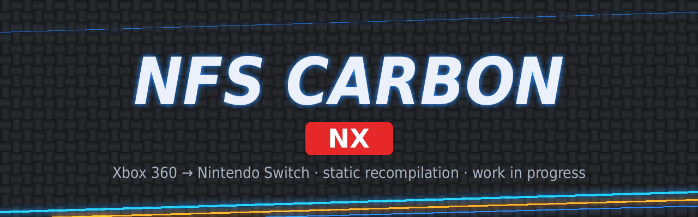

<div align=center>



</div>
<h1 align=center>Need for Speed: Carbon — Nintendo Switch port (nfscarbon-nx)</h1>

An **unofficial, work-in-progress** native Nintendo Switch port of the Xbox 360 version of **Need for Speed: Carbon**
(2006).

It is not an emulator. The PowerPC code of the game's `default.xex` is statically recompiled to C++ with
[ReXGlue](https://github.com/rexglue/rexglue-sdk), compiled for the Switch with devkitA64, and the game is drawn by a
native Vulkan renderer running on NVK (Mesa).

> [!IMPORTANT]
> **This is a starting point, not a finished port.** The game boots, the menus work and races are playable, but at
> the Switch's stock clocks it runs at **13-25 FPS** and the sound breaks up in crowded races. With an overclock it
> holds 30 FPS. The repository is public so that others can pick it up and take it further: see
> [How to help](#how-to-help).

> [!NOTE]
> **Made with Claude.** This port was put together by someone without a background in recompilation, GPU drivers
> or console development, working step by step with [Claude](https://claude.ai) (Anthropic's AI assistant): Claude
> wrote and changed the code and the build scripts, and the testing on a real console, the logs and the decisions
> were mine. Treat the code accordingly, review it, and do not assume something is right because it is here.
> Corrections are very welcome.

## Where it stands

Tested on a Switch Lite (handheld, 1280x720), USA disc version, all settings as shipped in `nfscarbon.toml`.

| Clocks (CPU / GPU / RAM, MHz) | Menus | Canyon race | Race Wars (crowded) | Sound in Race Wars |
|---|---|---|---|---|
| **1020 / 460 / 1331 (stock)** | ~25 FPS | 16-19 FPS | 13-18 FPS | breaks up |
| 1683 / 844 / 2133 | 30 FPS | 25-30 FPS | 25-30 FPS | fine |
| 1785 / 921 / 2133 | 30 FPS | 30 FPS in most places | 30 FPS in most places | fine |
| 1963 / 1152 / 2133 (max) | 30 FPS | steady 30 FPS | steady 30 FPS | fine |

The game is locked to 30 FPS by design, as on the Xbox 360.

Where the time goes at stock clocks (Race Wars, measured on the console; details in
[docs/measurements.md](docs/measurements.md)): the three CPU cores are 270-290 % busy out of 300 %. The renderer
thread needs 45-50 ms per frame, the GPU 35-44 ms (budget: 33 ms). The game's own threads (frame preparation, main
thread, audio mixer) fill the rest. There is no single big bug left: it is many medium-sized costs.

### Known issues

- **Slow frame rate at stock clocks**, above all in crowded races (Race Wars).
- **Sound breaks up in crowded races at stock clocks** ("slow motion", popping). The game's mixer keeps only two
  5 ms blocks ahead, so any delay on a saturated CPU loses a block. Fine with an overclock.
- **Intro videos (EA logo, attract) play slowly at stock clocks**, normal with an overclock.
- **A second car shadow**: a dark patch beside and behind the player's car, as if an invisible car were next to it.
- **A short freeze when the player takes control** at the start of a race.
- **The first race stutters** while it compiles graphics pipelines. They are saved on the SD card
  (`cache/carbon_gpu`), and later sessions start smoothly.
- **Only the USA edition** is supported (see [Edition](#edition)).

## What you need

- A Switch that can run homebrew (custom firmware, Atmosphère).
- **Your own copy** of the Xbox 360 game, USA edition: a disc image (`.iso`) or the extracted disc with its
  `default.xex`. No game files (graphics, sound, video, data) are included here or in the releases.

## Install (prebuilt NRO)

1. Download `nfscarbon-nx.nro` and `nfscarbon.toml` from the [Releases](../../releases) page.
2. Put them on the SD card with the files of your disc:

   ```text
   sdmc:/switch/nfscarbon-nx/
     nfscarbon-nx.nro
     nfscarbon.toml            (settings)
     game_root/                (the files of your disc: default.xex, NFS/, MOVIES/, ...)
   ```

   A `.iso` next to the NRO also works instead of `game_root/`. To extract a disc image on a PC:
   `python3 tools/fase1_extraer.py path/to/game.iso -o game_root`.
3. Launch it with **title takeover** (hold **R** while starting any installed game) or with a forwarder that uses a
   **39-bit address space**. Album (applet) mode does not give enough memory.

Logs are written to `sdmc:/switch/nfscarbon-nx/logs/`. Saves go to `nfscarbon/` next to the NRO.

## Build from source

Linux or WSL (Windows). Tested on WSL with Ubuntu. You need:

- [devkitPro](https://devkitpro.org/wiki/Getting_Started) with `switch-dev` (devkitA64 and libnx);
- CMake 3.25+, Ninja, Python 3.10+, Clang 20 or newer for the PC tools, Docker (for Mesa);
- about 16 GB of RAM (32 GB recommended) and 40-60 minutes for the final link with LTO.

| Step | Command | Time |
|---|---|---|
| 1. Third-party sources | `python3 tools/fetch_thirdparty.py` | a few minutes |
| 2. Extract your game to `assets/game_root` (ignored by git) | `python3 tools/fase1_extraer.py path/to/game.iso -o assets/game_root` | a few minutes |
| 3. NVK driver (Mesa, in Docker) → `out/mesa-sdk` | `bash tools/build_mesa_wsl.sh` | ~1 hour the first time |
| 4. Code generator for your PC → `sdk/out/linux-amd64/rexglue` | `CLANG=clang CLANGXX=clang++ bash tools/build_rexglue_wsl.sh` | ~15 minutes |
| 5. Translate the game to C++ → `app/generated/` (ignored by git) | `bash tools/codegen.sh` | ~5-7 minutes |
| 6. Build the NRO → `app/out/switch/nfscarbon.nro` | `bash tools/build.sh ~/nfscarbon-nx/out/mesa-sdk 4` | 40-60 minutes |

Notes:

- **Step 3**: `tools/build_mesa_wsl.sh` clones [mesa-switch](https://github.com/danfromtico/mesa-switch) at commit
  `1a8c1a66d6f`, applies `mesa/mesa-switch-nfsmw.patch` (from nfsmw-nx), fixes two problems of mesa-switch's Docker
  build (the Rust parts were built for the wrong CPU, and the archive index was broken) and checks the result. The
  driver is built from source on purpose, so anyone can see and change it.
- **Step 4**: the script's header lists the packages. `CLANG`/`CLANGXX` pick the compiler (by default `clang-20`).
- **Step 5** must be run again after any change to `app/nfscarbon_manifest.toml`, `app/overrides.toml` or after
  adding a hook in `app/src`. At the end it prints `hooked functions: N; calls made direct: M`.
- **Step 6** with `4` parallel jobs. More jobs need more RAM. The unstripped executable `app/out/switch/nfscarbon`
  is kept for `tools/symbolize_profile.py`.

## Settings

`nfscarbon.toml` describes each setting. The main ones:

| Setting | Default | What it does |
|---|---|---|
| `carbon_gpu_fps_cap` | `30` | frame rate cap (the game itself runs at 30) |
| `carbon_gpu_render_scale` | `100` | resolution in % of 1280x720. `50` makes the menus GPU-light |
| `carbon_gpu_reflection_faces` | `2` | car reflection cube faces redrawn per frame (6 = all) |
| `carbon_gpu_mirror_half_rate` | `true` | rear-view mirror at half rate |
| `nfscarbon_audio_mixer_priority` | `0x39` | Horizon priority of the game's audio mixer thread (0 = untouched) |
| `nfscarbon_handoff_sleep` | `true` | the game's two render threads sleep instead of spinning on `Sleep(0)` |
| `nfscarbon_renderer` | `carbon` | `carbon` native renderer, `xenos` the SDK's GPU emulation (slow, to compare) |

## How it works

| Folder | Contents |
|---|---|
| `app/` | The game: ReXGlue manifest, code generator options, hooks, Switch settings, CMake project |
| `app/renderer/` | Carbon's native Vulkan renderer: reads the game's GPU command ring and draws it on NVK |
| `sdk/` | ReXGlue SDK with nfsmw-nx's Horizon (Switch) layer: memory, threads, audio, input, presentation, profiler |
| `mesa/` | The NVK driver patch (from nfsmw-nx) |
| `tools/` | Extraction, code generation, build scripts, profiler symbolizer |
| `docs/` | Measurements on the console and renderer notes |

1. **The game's code**: `rexglue codegen` translates `default.xex` to C++ with `app/nfscarbon_manifest.toml`
   (the function list from nfs-carbon-recomp). `tools/direct_calls.py` makes calls between unhooked functions
   direct, so LTO can inline them. The generated code is never committed.
2. **The Switch layer** (`sdk/`): the one nfsmw-nx runs on the console, almost unchanged.
3. **The renderer** (`app/renderer/`): from nfs-carbon-recomp. It translates Xenos shaders at run time and keeps
   a Vulkan pipeline cache on the SD card. On the Switch it is linked into the NRO.
4. **Hooks** (`app/src/`): the D3D ring wait sleeps instead of spinning, the frame handoff between the game's two
   render threads sleeps instead of `Sleep(0)` (ported from nfsmw-nx), the audio mixer thread priority, and a
   tolerance for indirect calls the analysis missed.

## How to help

The port is split into independent pieces in **[docs/roadmap.md](docs/roadmap.md)**: what each one is, what has
been measured so far, and where to start. Most of them are about the frame rate at stock clocks: the renderer's
per-draw CPU cost, the GPU passes, the audio mixer and the game threads.

When something goes wrong, please [open an issue](../../issues/new/choose) with:

- the clocks you used (stock or overclock, and which values);
- `sdmc:/switch/nfscarbon-nx/logs/nfscarbon_*.log` and `logs/rex/rex_perfil.log`;
- for a crash, the Atmosphère report from `sdmc:/atmosphere/crash_reports/`.

To see where a thread spends its time, put an empty file `perfil_pilas.flag` in `logs/rex/`, play for a minute,
and run `python3 tools/symbolize_profile.py rex_perfil.log app/out/switch/nfscarbon` on the PC with the same
build. See [CONTRIBUTING.md](CONTRIBUTING.md).

## Edition

Only the **USA (NTSC-U) disc version, without title update**: `Need for Speed - Carbon (USA) (En,Es)`.

| | |
|---|---|
| Title ID | `454107EC` |
| Media ID | `51D2B53F` |
| `default.xex` SHA-1 | `75ed29cfde2af689fb4f0615d743c07cab31b9da` |

The Europe edition (`(En,Nl,Sv,Da,Fi)`, Media ID `573FDB37`) has different code addresses. It would need its own
manifest and hook addresses (`tools/find_fingerprints.py` helps), as nfsmw-nx does per edition.

## Credits

This port only exists because of the work of these people and projects:

- **[Sampreeth004 — nfs-carbon-recomp](https://github.com/Sampreeth004/nfs-carbon-recomp)**: the recompilation of
  Need for Speed: Carbon (manifest, hooks) and the native Vulkan renderer. This port is built on it.
- **[StevensND — nfsmw-nx](https://github.com/StevensND/nfsmw-nx)**: the Switch port of Need for Speed: Most Wanted.
  Its SDK layer, NVK patch, toolchain and documentation are the reference this port follows, and several fixes
  (frame handoff, code generator options) are ports of its solutions.
- **[madelrandel-blip — NFSMW Recompiled](https://github.com/madelrandel-blip/NFSMW-Recompiled)**: the project
  nfsmw-nx started from.
- **[Tom Clay — ReXGlue SDK](https://github.com/rexglue/rexglue-sdk)**, built on the work of the
  **[Xenia](https://xenia.jp)** team.
- **[danfromtico](https://github.com/danfromtico/mesa-switch)** and **[NaGaa95](https://github.com/NaGaa95/mesa-switch)**:
  mesa-switch, NVK on Horizon.
- **[devkitPro](https://devkitpro.org)** and **[switchbrew](https://github.com/switchbrew/libnx)**: devkitA64 and
  libnx.
- **Electronic Arts and EA Black Box**: the creators of Need for Speed: Carbon.

## Legal

Unofficial fan project, no affiliation with Electronic Arts or Nintendo. "Need for Speed" is a trademark of Electronic
Arts Inc. The icon and banner in this repository are original artwork. The source tree contains no assets or
program code from the original game, and nothing generated from it: building translates the game's code on the
builder's own computer from their own copy. Users must provide their own legally obtained copy of the game. Running
homebrew requires custom firmware, which violates Nintendo's terms of service and can get a console banned.

Source code under GPL-3.0 (see [LICENSE](LICENSE)), inherited from nfsmw-nx and NFSMW Recompiled. The SDK keeps its
BSD-3-Clause license and the Mesa patch MIT ([THIRD_PARTY_NOTICES.md](THIRD_PARTY_NOTICES.md)).
